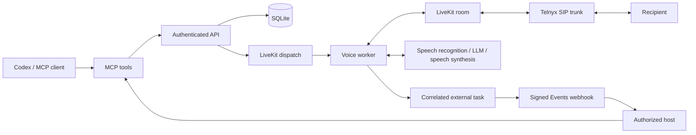

# Codex Call

An independent, MIT-licensed phone calling service for Codex and other MCP clients, using your own LiveKit, Telnyx, Anthropic, Deepgram and ElevenLabs accounts. This is not an official OpenAI product. The first release serves one operator.



The service persists calls and transcripts, enforces duration limits, and retries room cleanup. Its prompt-based worker supports spoken menus, keypad tones, hold periods and hangup. A task bridge lets an authorized host return results while a call waits; it does not share other apps' credentials.

| Capability | Implemented and offline tested | Live verification |
| --- | --- | --- |
| Authenticated API, SQLite lifecycle, idempotency, cancellation and restart recovery | Yes | Local HTTP tested |
| Seven MCP tools and stdio negotiation | Yes | Local SDK tested; actual Codex session unverified |
| LiveKit dispatch, SIP dialing, provider interfaces, transcript capture and worker tools | Yes, with remote boundaries substituted | Phone audio, providers, real IVR/hold unverified |
| Signed Events callbacks and correlated results | Yes, local HTTP/TLS and persistence tests | External callbacks and ChatGPT host unverified |
| Docker/Compose deployment | Packaged and statically reviewed | Image build/run unverified |

## Start in simulation

Install [uv](https://docs.astral.sh/uv/getting-started/installation/) and Python 3.11–3.13; Python 3.12 is the tested version. From a fresh checkout:

```sh
uv sync --locked --python 3.12
cp .env.example .env
uv run python - <<'PY'
import secrets
from pathlib import Path
path = Path('.env')
text = path.read_text()
text = text.replace('replace-owner-token', secrets.token_urlsafe(32))
text = text.replace('replace-worker-token', secrets.token_urlsafe(32))
path.write_text(text)
path.chmod(0o600)
PY
mkdir -p data
chmod 700 data
umask 077
uv run codex-call-api --host 127.0.0.1 --port 8000
```

These commands generate different tokens without printing them. Configuration loads `.env` from the project working directory. Leave `CODEX_CALL_MODE=simulate`: this creates local records and a simulated answered state, never a phone call. Simulation has no audio or generated transcript; end the simulated call with `codex_call_hangup_call`.

In another terminal, register the stdio MCP server using [the setup guide](docs/setup.md#codex-stdio-registration). The API remains a separate process. Live calling requires explicit `CODEX_CALL_MODE=live`, a configured SIP trunk, provider credentials and a separate worker.

## MCP tools

Every tool takes a single `params` object; client-specific wrappers may display it differently.

| Tool | Parameters / behavior |
| --- | --- |
| `codex_call_place_call` | `to_number` (E.164), `task`, required `idempotency_key`; optional `personality`, `max_duration_s` (30–1800, default 600) |
| `codex_call_get_call` | `call_id`; includes persisted `mode`, lifecycle status and safe error code |
| `codex_call_list_calls` | `limit` (default 20, max 100), `offset`; summaries without briefings |
| `codex_call_get_transcript` | `call_id`; full single-call transcript with speaker roles |
| `codex_call_hangup_call` | `call_id`; cancels an active call and requests room cleanup |
| `codex_call_list_tasks` | `call_id`; pending/completed/expired/cancelled host tasks |
| `codex_call_submit_task_result` | `call_id`, `request_id`, `result`; identical retries accepted, changed/late results conflict |

Example `tools/call` parameters, safe to use only in simulation unless the call is authorized:

```json
{
  "name": "codex_call_place_call",
  "arguments": {
    "params": {
      "to_number": "+14155550123",
      "task": "Ask when the shop opens; make no purchases or commitments.",
      "idempotency_key": "shop-hours-001"
    }
  }
}
```

Reuse the same key and identical payload when retrying one request. Queued or answered status is not evidence that a task succeeded. Inspect final status and transcript. The independently written [calling skill](skills/codex-call/SKILL.md) captures this workflow; it is packaged here and not installed automatically.

## Operation and development

See [setup](docs/setup.md) for Telnyx/LiveKit configuration, separate API and worker processes, Docker, storage permissions and retention. See [Events](docs/events.md) for the opt-in host bridge and HTTP MCP protocol requirements.

Run one API process per database. Startup marks interrupted calls failed and requests room cleanup; it does not redial them. This release has no multi-instance HA, inbound answering, human transfers, billing, dashboard or recordings. Transcripts and event secrets persist locally until the operator removes the database and its backups.

```sh
uv run pytest -q
uv run ruff check .
uv run ruff format --check .
uv build
uv run codex-call-api --help
uv run codex-call-worker --help
uv run codex-call-worker start --help
uv run codex-call-mcp --help
```

Tests exercise local authentication, SQLite, subprocess CLI/stdio, SDK contracts and simulated network boundaries. They do not exercise phone audio, live provider access or ChatGPT integration. CI uses locked dependencies and Python 3.12. The [MIT license](LICENSE) covers this original source. Dependencies are installed separately, not vendored; their licenses and provider account terms still apply (see [dependency licensing](docs/setup.md#dependency-licensing)).
