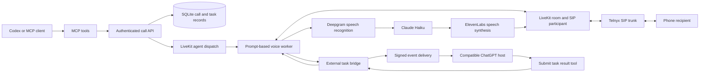

# Codex Call — proposed first release

Status: approved first-release design.

## Product

Codex Call is an independently implemented, MIT-licensed service for making AI phone calls from Codex and other MCP clients. It uses the operator's own telephony, audio, and model accounts. The proposed publication destination is the public repository `rparikh420/codex-call`.

The name describes an integration; the project is independent and is not an official OpenAI product.

## What is available from ClawCall

ClawCall's public repository distributes its agent skill and MCP integrations. Its hosted calling backend is not included. The repository's integration components are MIT-licensed, and its skill uses MIT-0. Forking that repository creates a connector to ClawCall's service, rather than an independent phone service.

Source: https://github.com/ClawCall-Dev/ClawCall

## Approaches

1. **Independent calling service — recommended.** Own the backend and voice worker, use our provider accounts, and publish original source. This requires implementing call lifecycle and integrations but gives us a reusable foundation.
2. **Connector fork.** Adapt the public MCP package for Codex and retain the required license notices. This is smaller, but phone execution still depends on ClawCall's account, pricing, and private service.
3. **Full commercial platform.** Add multi-tenant accounts, billing, inbound numbers, recording storage, and a dashboard. This is a separate expansion after the calling foundation works.

## Recommended architecture

Python will host the API and LiveKit Agents worker. The voice agent uses a system prompt, task instructions, conversation history, and tools; it does not require a graph engine. Provider model identifiers remain configurable, with Haiku as the intended default.

Telnyx supplies the phone number and SIP trunk. LiveKit handles media transport and the room. The operator configures the trunk once; provider credentials remain outside Git. The application uses LiveKit's documented SIP integration rather than inventing a media bridge.

## First-release behavior

- Accept an outbound call request with an E.164 destination and a task briefing.
- Persist its lifecycle, timestamps, errors, and transcript.
- Dispatch the voice worker and dial through the configured LiveKit outbound SIP trunk.
- Run a conversational prompt-based agent, including spoken phone menus, DTMF, hold periods, and explicit hangup.
- Enforce a configured maximum call duration and terminate rooms on cancellation or failure.
- Expose MCP tools for placing calls, inspecting status and transcripts, listing calls, and ending calls.
- Provide a Codex setup guide and an independently written calling skill.
- Offer an explicit external-task tool: the voice worker can request work, wait until a deadline, and receive a correlated result from the host. Calling this tool does not give the service access to other plugins' credentials.

The first release targets a single operator. Authentication protects the API and internal worker updates. A local stdio MCP connection supports Codex without a public OAuth deployment. A remote ChatGPT installation additionally requires public HTTPS and a compatible authorization configuration.

## ChatGPT events and result bridge

Treat the host integration as a distinct interface, with these requirements:

- Advertise and negotiate MCP Events only when the supported protocol and host allow it.
- Store subscriptions and sign outbound webhook delivery according to the documented event contract.
- Bind every request to a call, a unique request identifier, and an expiry time.
- Accept results through an authenticated tool or endpoint, with idempotency and duplicate detection.
- Cancel pending requests when the call ends; ignore late results.
- Retry temporary webhook delivery failures without creating another logical request.
- Keep the webhook acknowledgment separate from the eventual task result.

A compatible ChatGPT host may run separately authorized connected-app actions and then submit the result. There is no direct credential sharing or automatic access to every user plugin. Host compatibility must be reported separately from local protocol tests.

Primary specification: https://developers.openai.com/plugins/build/mcp-events

## Failure handling and verification

Reject malformed destinations and empty tasks before dispatch. Provider and dispatch failures must produce durable terminal states. Cancellation must also clean up the room. Restarts must not cause a duplicate dial for the same request.

Automated tests will cover call lifecycle, authentication, request idempotency, transcript persistence, cancellation, task correlation, timeout, signed event delivery, and duplicate results. SDK integration checks will verify the actual installed provider interfaces. An offline demonstration must be clearly labeled as simulated.

Real phone/audio verification needs operator-supplied provider credentials and an authorized test destination. Publication alone is not proof of a completed live call or a ChatGPT end-to-end integration.

## Release boundary

Publish original product code, tests, generic configuration examples, setup documentation, and an MIT license. Use a clean publication checkout, inspect all tracked files and history, and verify both the active GitHub identity and destination ownership before every remote write.

Do not include research downloads, source/reference checkouts, personal configuration, credentials, private organization material, or local source-traceability records.

Inbound answering, attended human transfers, recording storage, subscriptions/billing, and a customer dashboard are later extensions. They are not acceptance criteria for this first release.

## Acceptance criteria

1. A fresh checkout installs and runs from documented commands.
2. Codex can discover the MCP tools and use them against the authenticated API.
3. The outbound worker connects through the documented LiveKit/Telnyx path using configurable providers.
4. Call and external-task state transitions have passing tests, including failure and cancellation paths.
5. The README clearly identifies implemented, simulated, and unverified integrations.
6. The complete reviewed publication contains only original or appropriately licensed public material.
7. The reviewed repository is published to `rparikh420/codex-call`, and its remote commit is verified.
